---

## Screenshot

### 1. Halaman utama (menampilkan daftar tugas)

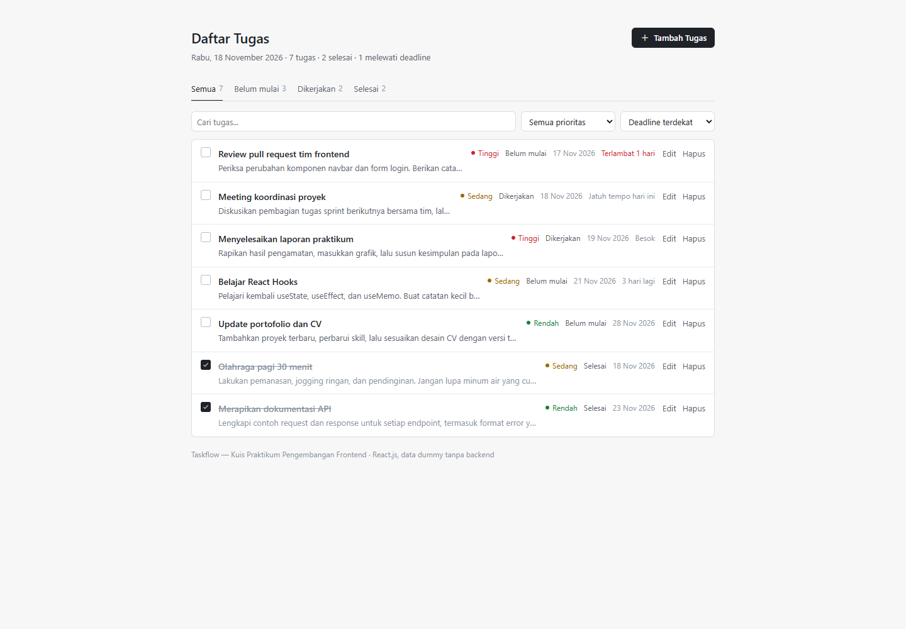

### 2. Detail tugas

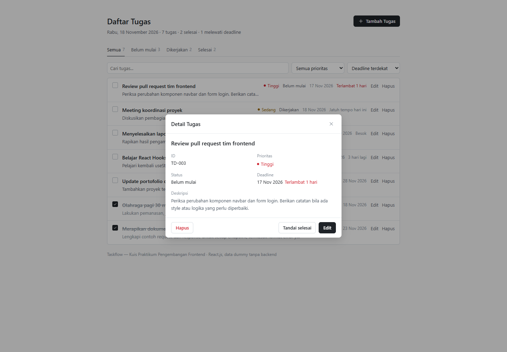

### 3. Form tambah tugas

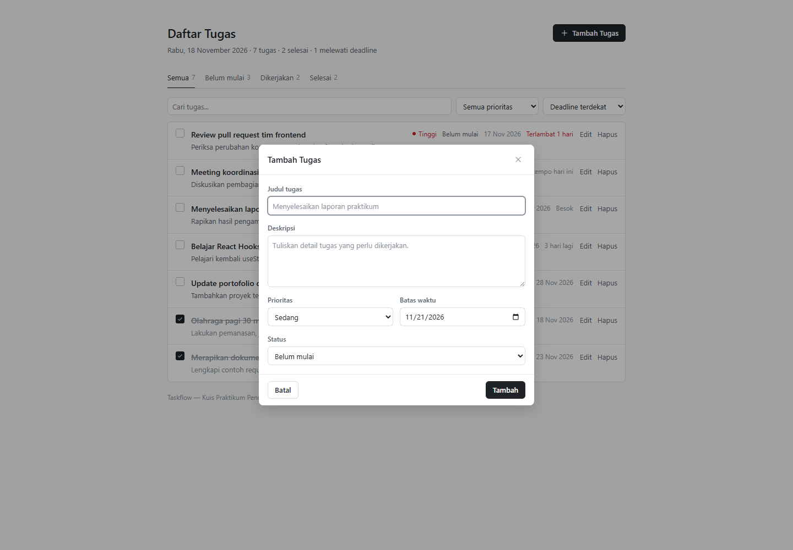

### 4. Validasi form

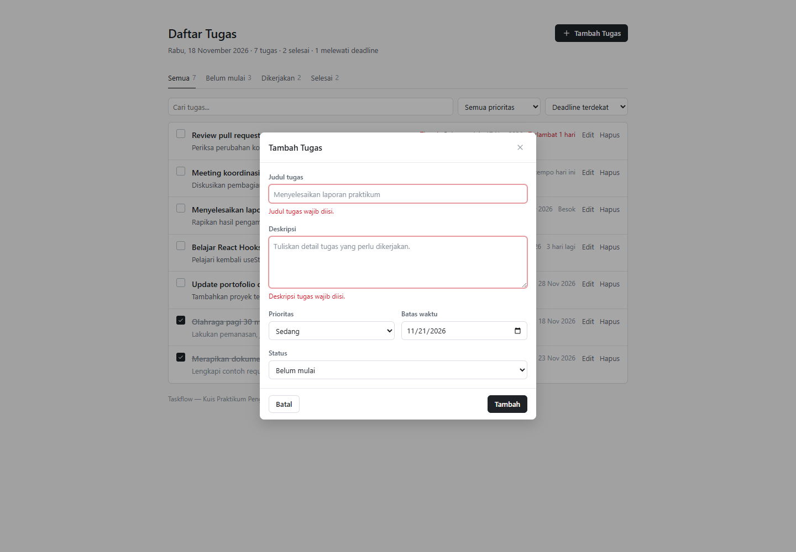

### 5. Tugas berhasil ditambahkan

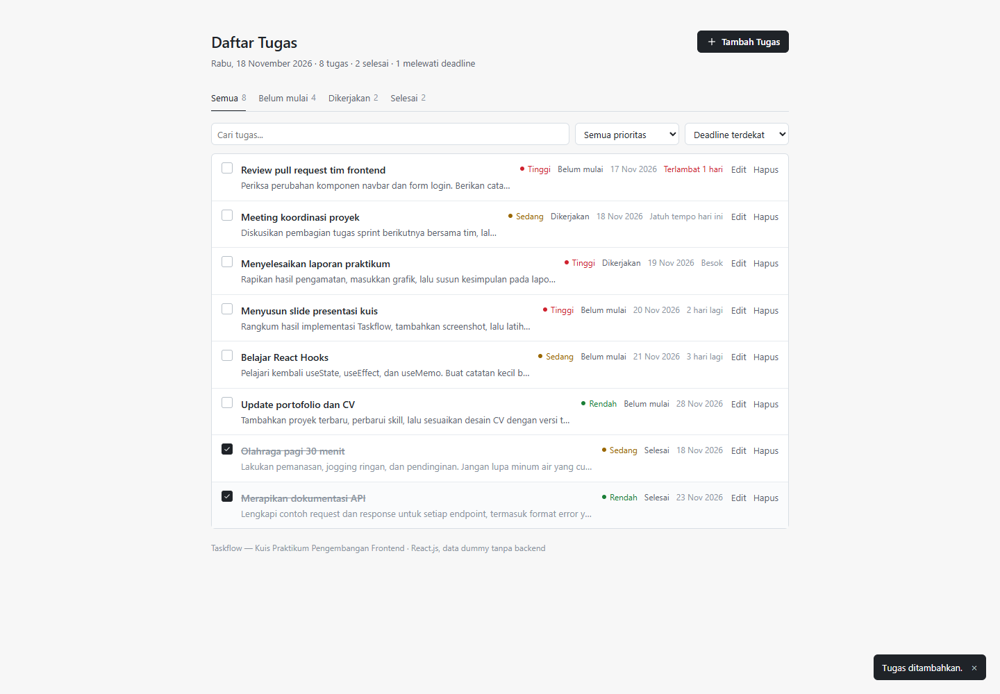

### 6. Form edit tugas

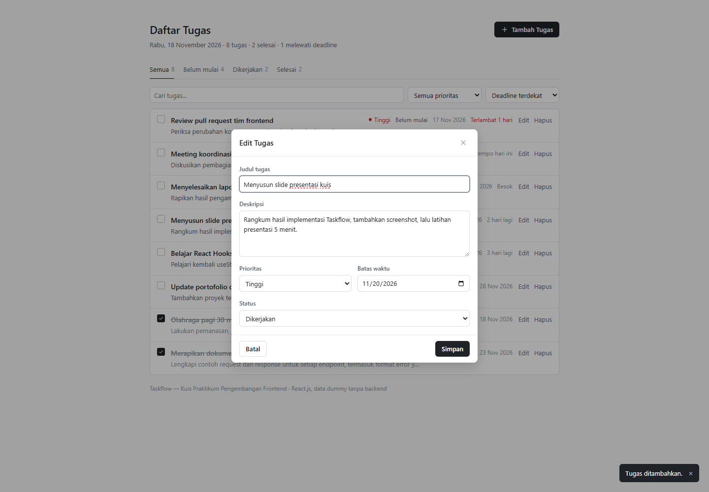

### 7. Konfirmasi hapus tugas

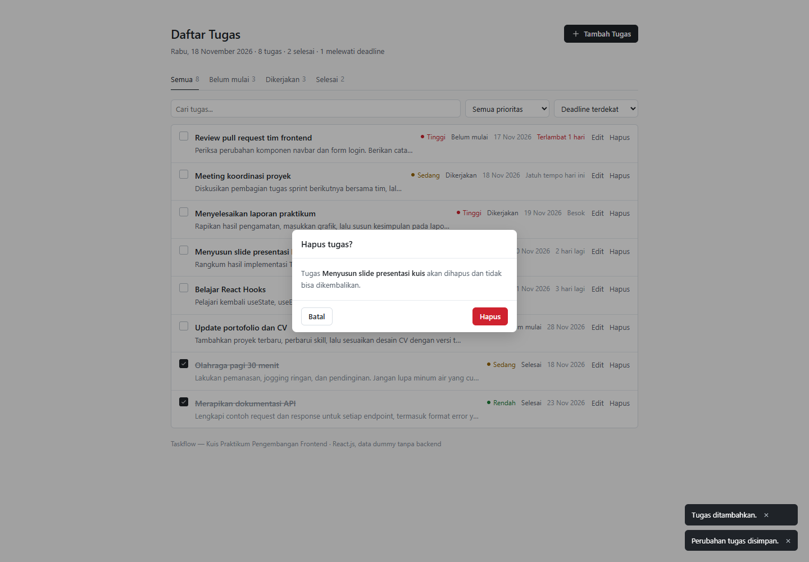

### 8. Setelah tugas dihapus

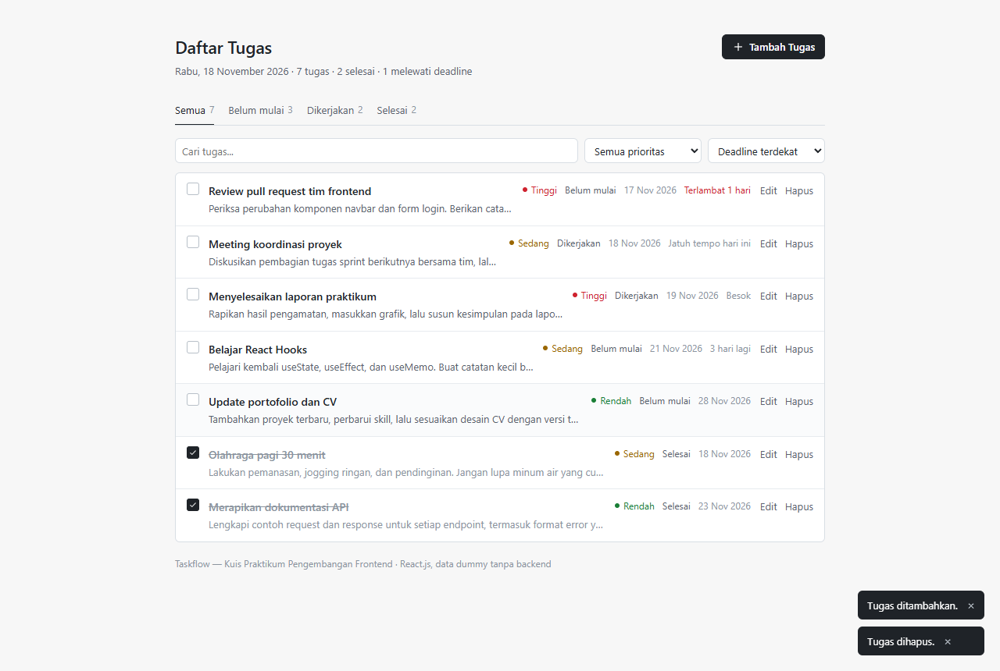

### 9. Pencarian tanpa hasil

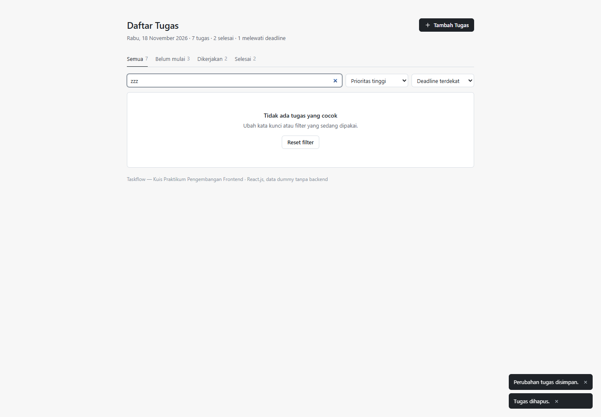

### 10. Filter status "Selesai"

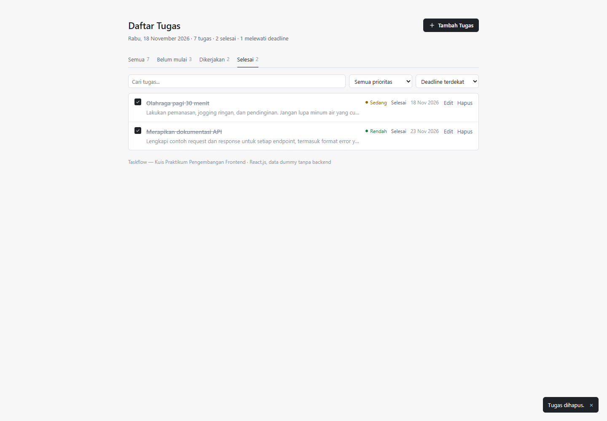

### 11. Tandai tugas selesai

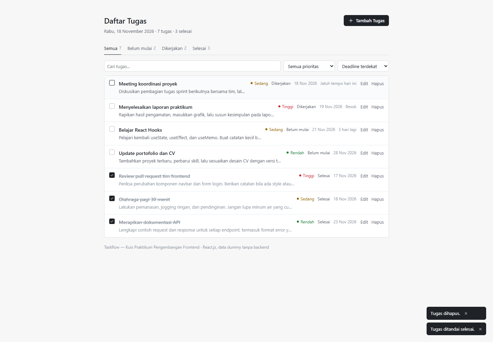

---